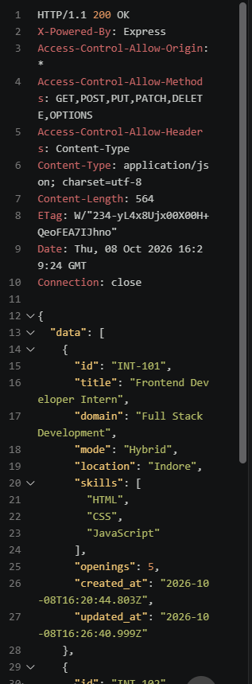
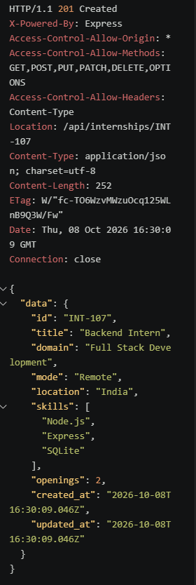
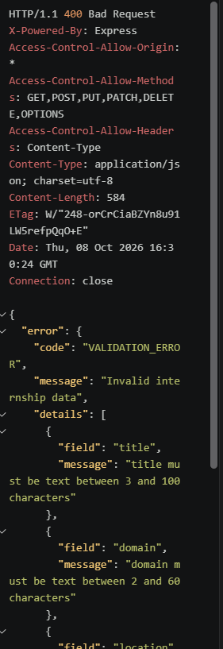

# Internship API

REST API for internship records. Built with Node.js, Express and SQLite (`better-sqlite3`). Includes validation, pagination, search filters and consistent error responses.

## Run locally

```bash
npm install
npm start
```

The server runs at `http://localhost:3000`. On the first start it creates `internships.db` and loads 5 sample records from `data/internships.json`.

## Data model

| Field | Type | Rules |
|---|---|---|
| id | text | Created by the server, like `INT-106` |
| title | text | 3 to 100 characters |
| domain | text | 2 to 60 characters |
| mode | text | `Remote`, `Hybrid` or `On-site` |
| location | text | 2 to 60 characters |
| skills | list of text | 1 to 10 items, max 40 characters each |
| openings | integer | 0 to 1000 |
| created_at, updated_at | text | ISO date, set by the server |

## Endpoints

| Method | Path | Success | Description |
|---|---|---|---|
| GET | `/health` | 200 | Server check |
| GET | `/api/internships` | 200 | List with pagination and filters |
| GET | `/api/internships/:id` | 200 | One internship |
| POST | `/api/internships` | 201 | Create |
| PUT | `/api/internships/:id` | 200 | Replace (all fields required) |
| PATCH | `/api/internships/:id` | 200 | Update only the fields sent |
| DELETE | `/api/internships/:id` | 204 | Delete |

### List query options

`?page=1&limit=10&q=sql&domain=UI/UX&mode=Remote`

- `page` starts at 1. `limit` is 1 to 50 (default 10).
- `q` searches title, location, domain and skills.

## Response format

Success:
```json
{
  "data": [ { "id": "INT-101", "title": "Frontend Intern", "skills": ["HTML", "CSS", "JavaScript"], "...": "..." } ],
  "meta": { "page": 1, "limit": 10, "total": 5, "totalPages": 1 }
}
```
Single records return `{ "data": { ... } }`.

Error:
```json
{
  "error": {
    "code": "VALIDATION_ERROR",
    "message": "Invalid internship data",
    "details": [ { "field": "mode", "message": "mode must be one of: Remote, Hybrid, On-site" } ]
  }
}
```

## Status codes

- 200 OK, 201 Created, 204 No Content
- 400 Bad Request (`VALIDATION_ERROR`, `INVALID_JSON`)
- 404 Not Found (`NOT_FOUND`)
- 500 Server Error (`SERVER_ERROR`)

## Try it

Open `requests.http` in VS Code with the REST Client extension, or use curl:

```bash
curl "http://localhost:3000/api/internships?page=1&limit=2"

curl -X POST http://localhost:3000/api/internships \
  -H "Content-Type: application/json" \
  -d '{"title":"Backend Intern","domain":"Full Stack Development","mode":"Remote","location":"India","skills":["Node.js","SQLite"],"openings":2}'
```

## Screenshots







## What I learned

I learned how to build a REST API with Express and store data in SQLite so it stays after a restart. I added validation on the server and used clear status codes (201, 400, 404) so the client knows what happened. I also learned how pagination and search filters work with query parameters.